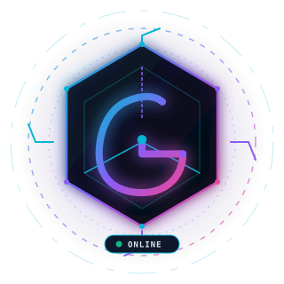
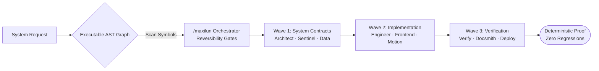

# ⚡ SHALAHUDDIN GIRI PAMUNGKAS
### `@giriedu` · AI Systems Architect & Creative Software Engineer

  <strong>Jakarta, Indonesia (UTC+7) · Autonomous AI Orchestration · Executable AST Graphs · Quantitative Risk Engines · 3D WebGL Motion</strong>

---

[🚀 **Launch Interactive 3D Cinematic Portfolio & HUD Terminal &rarr;**](https://giriedu.github.io/myctr/)

---

## 🌌 Overview & Engineering Philosophy

I engineer deterministic autonomous agent architectures, code discovery knowledge graphs, quantitative risk models, and high-framerate motion web systems.

- **Reversibility-Gated Triage:** Act on concrete repository evidence first; clarify only irreversible decisions.
- **AST-Accurate Precision:** Zero hallucinated line references; semantic code graph discovery via polyglot AST scanners.
- **Minimalist Engineering:** Stdlib-first architectures, low cognitive load, zero ceremonial AI slop.

---

## 🛠️ Flagship Ecosystem

| Project | Description | Stack / Highlights | Link |
|---|---|---|---|
| **[Maxilun](https://github.com/giriedu/maxilun)** | Autonomous AI engineering co-pilot featuring 18 specialist skills, 1 orchestrator, in-process Knowledge Graph with 3D WebGL Galaxy visualizer, and zero-dependency Python stdlib harness. | Python Stdlib, Polyglot AST, 3D WebGL, Multi-Agent Waves, Purity Gate | [giriedu/maxilun](https://github.com/giriedu/maxilun) |
| **[Maxilun-Trade](https://github.com/giriedu/maxilun-trade)** | Quantitative day trading, market intelligence, algorithmic risk engine, and broker execution orchestrator engineered specifically for AI agents. | Algorithmic Trading, Market Intel, Risk Engine, Low-Latency Async | [giriedu/maxilun-trade](https://github.com/giriedu/maxilun-trade) |
| **[SIFORMA](https://github.com/giriedu/siforma)** | Sistem Formulir Mandiri — Interactive dynamic form builder with declarative schema validation and instant state hydration. | Form Engine, State Hydration, Dynamic Schema, Responsive UX | [giriedu/siforma](https://github.com/giriedu/siforma) |
| **Ruang Digital & Public Platforms** | Modern civic digital platform and educational systems for public services. | Full-stack Web, Identity, Scalable Architecture | [giriedu](https://github.com/giriedu) |

---

## ⚡ Multi-Wave Engineering Architecture

---

## 🧰 Technology Radar

- **AI & Autonomous Agents:** Multi-Agent Wave Coordination, Purity Engines, Local Model Runtimes (Ollama, DeepSeek, Claude, GPT-4o), AST Knowledge Graphs.
- **Frontend & Creative Engineering:** WebGL, Canvas 2D/3D Shaders, Three.js, Damped Spring Physics, OKLCH Color Design Systems, Procedural Web Audio API.
- **Backend & Quantitative Infrastructure:** Python Stdlib Runtimes, Event-Driven Async I/O, Quantitative Trading Risk Orchestrators, Cryptographic Integrity.

---

## 🎮 Interactive Features of This Repository

This repository (`myctr`) hosts the full interactive web application via GitHub Pages:
- 🌌 **Hyper-Space Warp Canvas:** Real-time particle constellation with mouse gravity and lightspeed warp drive.
- 🎛️ **Procedural Web Audio Synthesizer:** Zero-asset sound engine generating real-time sci-fi HUD chirps and sub-bass whooshes.
- 💻 **Interactive In-Browser HUD Terminal:** Live CLI supporting directives like `whoami`, `skills`, `projects`, `warp`, `sound`, and `matrix`.
- 🪟 **3D Perspective Hologram Cards:** Interactive pointer-tracking spotlights and gyroscope-like depth.

Visit the live site: [https://giriedu.github.io/myctr/](https://giriedu.github.io/myctr/)

---

  Shalahuddin Giri Pamungkas &copy; 2026 · All systems operational.

